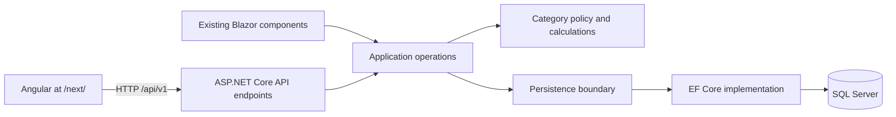

# RopeParison: architecture review and major-update plan

Reviewed: 17 September 2026\
Repository: `C:\Users\Luke\source\repos\rope-parison`\
Branch: `major-update`, created from `main`\
Baseline commit: `4e5659dd81b65fa6605eaa259686f51268c1306f`\
Scope: original review and proposed resolution plan. Subsequent progress: regression tests added and the .NET 10 upgrade completed locally; see [upgrade evidence and remaining limitations](reviews/DOTNET10_UPGRADE.md). On 18 September the initial validation, edit, calculation and transactional approval fixes passed all 47 tests; see [fixes and remaining limits](reviews/DEFECT_FIXES.md). Backend shared-password enforcement is now implemented; individual sign-in is required but explicitly deferred, with Google accounts also under consideration. See [authorization implementation and deferred sign-in](reviews/BACKEND_AUTHORIZATION.md). Missing-record handling, SQL name uniqueness and rowversion checks have also been implemented and migrated locally; see [record integrity results](reviews/RECORD_INTEGRITY.md). Grouped edit submission and approval is now implemented, including category changes with dependent measurements; see [grouped submission results](reviews/GROUPED_EDIT_SUBMISSIONS.md). Filtering and selection fixes (F13/F18) are now verified, including callback ordering, empty selections and mode changes; see [filtering and selection results](reviews/FILTERING_AND_SELECTION.md). Azure state storage is now created and both Terraform states use protected Blob backends. Nine existing app/shared SQL resources were imported without infrastructure changes; fresh plans for both configurations show no changes. Follow-up Terraform review fixes now protect stable SQL inputs, support first use, guard deployment and bound previous state versions; see [fix verification](reviews/TERRAFORM_ADOPTION_FIXES.md). Credential-free infrastructure CI is now implemented and locally verified; see [CI evidence and limits](reviews/INFRASTRUCTURE_CI.md). Federation, trusted plans and reviewed applies remain pending. See [Azure inventory and Terraform adoption](infra/AZURE_INVENTORY.md). Findings below describe the reviewed baseline unless stated otherwise.

## Assessment

The project is small enough to improve incrementally. Keep the C# backend and make its application operations safe and independent of the UI before building Angular against them. Add Angular alongside Blazor first, then decide whether to retain both after a representative feature has reached parity.

There are real structural issues behind the individual bugs:

- A write operation has no single owner for authorization, validation, persistence, and derived calculations. Those responsibilities are spread between Razor components, Logic, and Data.
- The shared `RopeDto` combines editable input, database output, moderation data, and mutable chart state. It is unsuitable as the public API contract without separation.
- Category rules and field metadata are repeated across validation, normalization, forms, grids, and charts. Adding another UI would multiply that duplication.
- Repository methods create and save independent contexts, preventing larger business operations from being atomic.
- The project has no automated regression suite or pull-request validation workflow to protect a migration.

These are not reasons to discard Blazor or rewrite the database. The existing service interfaces, short-lived context factory pattern, EF migrations, and separation into projects provide a useful starting point. There is no demonstrated need for microservices, a message bus, a generic repository framework, or two backend implementations.

## Scope and verification

Inspected the five project definitions, startup and configuration, data models and migration snapshot, data and business services, validation and category rules, the main CRUD/moderation component, selection and chart flows, legacy routes, and deployment workflow. Existing `CLAUDE.md` was read as context and its claims checked against source; it was already untracked and was left untouched. No `AGENTS.md` was found in the repository or inspected parent directories.

Executed:

```powershell
dotnet build RopeParison.sln --configuration Release --nologo -v minimal
dotnet list C:\Users\Luke\source\repos\rope-parison\RopeParison.sln package --vulnerable --include-transitive --format json
```

- Release build: **passed, 117 warnings, 0 errors**, using installed SDK 8.0.200 to build the existing .NET 7 targets. Warnings include nullability, unawaited calls, and component-parameter usage.
- Dependency audit: **eight distinct transitive package IDs** flagged in the web project's resolved dependency graph; repeated appearances in other projects are not additional distinct packages.
- A temporary .NET 8 diagnostic harness, outside the application repository, exercised the compiled Release assemblies with a recording substitute for the data service. It also inspected the real EF model and translated queries with the SQL Server provider without opening a connection.
- The initial code review did not connect to a database. The subsequent BACPAC audit below imported the supplied snapshot into an isolated local SQL Express database and inspected its data read-only. Live Azure settings/deployment, full browser workflows, and concurrent SQL transaction tests remain unverified. Source-level risks are not claimed production incidents.
- The first query-translation probe used the SqlClient facade assembly and could not execute. Repeating with the application's Windows runtime assembly produced the translation results recorded below.

Code references below are repository-relative paths and baseline line numbers; they will move as fixes are made.

## Priority guide

**P1:** address promptly, or before exposing backend writes to Angular. **P2:** fix as part of the major update. No finding here asserts a confirmed production compromise.

| ID | Priority | Finding | Evidence type |
| --- | --- | --- | --- |
| F01 | P1 | Unsupported runtime and dependencies with security advisories | Build configuration, live NuGet audit |
| F02 | P1 | Deployment uses retired artifact actions | Workflow, GitHub retirement notice |
| F03 | P1 | Authorization resides in Razor handlers; configured passwords have committed fallbacks | Source tracing |
| F04 | P1 | Application writes do not enforce validation; validator misses invalid measurements | Executed diagnostic checks |
| F05 | P1 | Suggestion approval and derived calculations are separate commits | Source tracing |
| F06 | P2 | Updates and approvals do not normalize category-dependent values | Executed diagnostic check, source tracing |
| F07 | P2 | Unchanged categories generate edit suggestions | Executed diagnostic check |
| F08 | P2 | Calculated sheath thickness is twice the radial thickness | Executed diagnostic check |
| F09 | P2 | DTO mapping drops the verification flag | Executed diagnostic check |
| F10 | P2 | Missing rope IDs cause a null dereference | Executed mapping check, source tracing |
| F11 | P2 | Name uniqueness is not enforced by the database | EF model inspection, source tracing |
| F12 | P2 | Moderation has no concurrency token or durable decision history | EF model inspection, source tracing |
| F13 | P2 | Legacy category filter cannot translate to SQL; publication defaults differ | Executed translation check, source tracing |
| F14 | P2 | Untracked asynchronous handlers and UI work outside the renderer context | Source tracing, compiler warnings |
| F15 | P2 | Read operations are synchronous and unbounded | Source tracing |
| F16 | P2 | No HTTP API; shared DTOs expose UI and persistence concerns | Architecture inspection |
| F17 | P2 | Business rules and UI orchestration are duplicated | Source inspection |
| F18 | P2 | Empty selection and selection-mode changes have surprising behavior | Source tracing |
| F19 | P2 | No automated regression or PR validation safety net | Tracked-file and workflow inspection |

## Detailed findings

### F01 — Unsupported runtime and vulnerable dependency versions

**Evidence:** all five `.csproj` files target `net7.0`; EF Core is pinned to 7.0.8. The NuGet audit identified the following packages in the web project's dependency graph:

| Package | Resolved version | Highest reported severity | Advisory |
| --- | --- | --- | --- |
| System.Drawing.Common | 5.0.0 | Critical | [GHSA-rxg9-xrhp-64gj](https://github.com/advisories/GHSA-rxg9-xrhp-64gj) |
| Azure.Identity | 1.6.0 | High | [GHSA-5mfx-4wcx-rv27](https://github.com/advisories/GHSA-5mfx-4wcx-rv27), plus two Moderate advisories |
| Microsoft.Data.SqlClient | 5.0.2 | High | [GHSA-98g6-xh36-x2p7](https://github.com/advisories/GHSA-98g6-xh36-x2p7) |
| System.Formats.Asn1 | 5.0.0 | High | [GHSA-447r-wph3-92pm](https://github.com/advisories/GHSA-447r-wph3-92pm) |
| System.Text.Json | 7.0.0 | High | [GHSA-hh2w-p6rv-4g7w](https://github.com/advisories/GHSA-hh2w-p6rv-4g7w) |
| Microsoft.AspNetCore.Components | 7.0.1 | Moderate | [GHSA-3fx3-85r4-8j3w](https://github.com/advisories/GHSA-3fx3-85r4-8j3w) |
| Microsoft.IdentityModel.JsonWebTokens | 6.21.0 | Moderate | [GHSA-59j7-ghrg-fj52](https://github.com/advisories/GHSA-59j7-ghrg-fj52) |
| System.IdentityModel.Tokens.Jwt | 6.21.0 | Moderate | [GHSA-59j7-ghrg-fj52](https://github.com/advisories/GHSA-59j7-ghrg-fj52) |

.NET 7 support ended on 14 May 2024. For this update, target a current .NET 10 LTS patch with compatible EF Core and UI packages; .NET 8 support ends in November 2026, making it a poor long-term destination for a migration starting now. See Microsoft's [end-of-support notice](https://devblogs.microsoft.com/dotnet/dotnet-7-end-of-support/) and [current support policy](https://dotnet.microsoft.com/en-us/platform/support/policy).

**Impact:** the application carries unsupported components and known affected package versions. The audit does not prove each vulnerability is reachable. For example, the System.Drawing advisory requires particular graphics parsing on macOS/Linux; no such attack path was established here. Production runtime and OS were not inspected.

**Resolution:** inventory dependency chains, upgrade their owning packages together, remove unused packages, and re-audit the resolved graph. Check Syncfusion compatibility and licensing before selecting its replacement version. Pin the SDK in `global.json` and align CI and hosting. Do not assume changing `TargetFramework` removes explicit/transitive vulnerable packages.

**Acceptance:** restore/build/publish on the selected SDK; supported hosting runtime; clean or explicitly triaged vulnerability audit; chart, form, and validation smoke tests after the package update.

### F02 — The deployment pipeline uses retired artifact actions

**Evidence:** `.github/workflows/main_ropeparison.yml:32,46` uses `actions/upload-artifact@v3` and `actions/download-artifact@v3`; lines 20–23 select `setup-dotnet@v1`, .NET `7.x`, and prereleases. GitHub retired the v3 artifact actions on GitHub.com on 30 January 2025. [GitHub notice](https://github.blog/changelog/2024-04-16-deprecation-notice-v3-of-the-artifact-actions/)

**Impact:** a successful local build does not establish that this workflow can deliver a new deployment. The committed workflow has a known obsolete artifact exchange. Its current remote run history was not inspected.

**Resolution:** upgrade both artifact actions to supported compatible versions, update SDK setup, and publish the web project explicitly rather than publishing the solution into one shared output directory. Build/test PRs independently from production deployment. Preserve production deployment only for the intended branch and environment.

**Acceptance:** a PR validation run passes; a staging deployment consumes the expected web artifact; production remains a separate deliberate deployment step.

### F03 — Authorization is not an application-service invariant

**Evidence:** `RopeParison/Pages/RopeAdd.razor:1205–1267` checks passwords before verify/delete/approve/reject. `RopeParison.Logic/Services/RopeService.cs:170–203` exposes those operations without caller identity or authorization. `Program.cs:22–47,71–78` configures no ASP.NET authentication/authorization. `appsettings.json:30–35` contains nonempty password defaults; `PasswordSecurityServiceSettingsBased.cs:23–41` accepts configuration values, and `PasswordSecurityService.cs:46–53` compares plain strings.

**Impact:** the existing password checks execute on the Blazor server; this is **not** evidence of a demonstrated client-side bypass. However, a new endpoint or alternate caller can invoke the underlying service without the check. If environment overrides are absent, committed fallback passwords become the active credentials. Shared credentials also provide no individual moderator attribution.

**Resolution:** introduce authenticated moderator identities and named policies for moderation/deletion. Enforce authorization at the application operation as well as the HTTP boundary so in-process Blazor calls remain protected. Remove usable password defaults; fail closed when required configuration is absent. Replace the shared-password scheme with an identity provider or ASP.NET Core Identity appropriate to the small moderator group. Rotate any committed default that has actually been used in production. Apply abuse controls to intentionally public submissions.

**Acceptance:** anonymous, ordinary, and moderator callers are tested through both API and direct application entry points; missing configuration cannot enable moderation; audit entries identify the moderator.

### F04 — Validation can be bypassed and does not cover the full input domain

**Evidence:** validation is invoked by `RopeAdd.razor:1301`; `RopeService.cs:122–130,133–168,170–192` never invokes the validator. `RopeDtoValidator.cs:33–36` comments out sheath percentage range checks, and the validator contains no drop-count or sheath-slippage rules. Brand/category are only checked for non-null objects, not valid identities.

**Reproduction:** an otherwise valid Single-rope DTO with sheath percentage 150, drops-before-break -5, and sheath slippage -1 passes the current validator. Calculation then produces `NaN` for core diameter. Calling `AddRope` with diameter zero reaches the recording data service and produces infinite density. This does not claim SQL Server successfully stores those non-finite values.

**Resolution:** validate every application command, including the merged result of an approval, before persistence. Check finite numeric values, required applicable measurements, optional-field ranges when present, defined category values, and existing brand IDs. Keep absence distinct from zero. Define meaningful bounds with domain input; do not invent standards limits during a software refactor. Narrow the validator's uniqueness dependency rather than introducing a service/validator dependency cycle.

**Acceptance:** invalid commands fail identically from Blazor and HTTP, with field-level errors and no database changes; calculation never receives invalid geometry.

### F05 — Approval is not one atomic operation and accepts unrelated IDs

**Evidence:** `RopeService.cs:170–180` first calls `ImplementRopeEditSuggestion(suggestionId)`, then loads a separately supplied `ropeId` and calls `UpdateRope`. `RopeDataService.cs:388–409` commits the changed rope and deletes the suggestion before the recalculation starts. `SubmitRopeEditSuggestion` also saves every changed field through a separate context/save (`RopeService.cs:142–165`, `RopeDataService.cs:343–355`).

**Impact:** failure after the first approval save leaves changed source measurements, stale calculated values, and a deleted suggestion. Supplying a suggestion for rope A with rope B's ID applies A's change but recalculates B. A failure halfway through a multi-field submission leaves a partial proposal.

**Resolution:** derive the rope identity from the persisted suggestion. Load, authorize, merge, normalize, validate, calculate, record the decision, and save within one operation/context. Save related submitted changes as one proposal transaction. A single relational `SaveChanges` is transactional; independent context saves do not make the whole workflow atomic. [EF transaction documentation](https://learn.microsoft.com/en-us/ef/core/saving/transactions)

**Acceptance:** inject a calculation/save failure and assert no partial approval or lost suggestion; mismatched IDs cannot select a different target; multi-field submission succeeds or fails as a unit.

### F06 — Category-dependent normalization only happens on creation

**Evidence:** `RopeService.cs:124–128` calls `SetRopeValuesNullBasedOnCategory` during add, but `UpdateRope` at 188–193 only recalculates. Approval directly changes the category in `RopeDataService.cs:508`. Category normalization is defined at `RopeService.cs:212–228`.

**Reproduction:** updating a Single-rope DTO containing `ImpactForce55kgOneStrand = 6` preserves that half-rope-only field through the data-service call. A Triple-to-Single category approval can therefore retain measurements inapplicable to the resulting category.

**Resolution:** use one category policy during every write. Validate the final aggregate, including newly required measurements when a category expands. Decide how category changes and their related field changes are approved together; merely clearing obsolete fields is insufficient when required new measurements are missing.

**Acceptance:** transitions between all five categories are covered; accepted ropes have only applicable values and all required measurements. Related changes cannot leave an invalid intermediate published state.

### F07 — Reference comparison creates spurious category suggestions

**Evidence:** `RopeAdd.razor:1135–1136` fetches the original and editable rope separately. `Category.ToDto()` constructs a new object (`RopeParison.Protocol/Enum/Category.cs:37–50`). `RopeService.cs:144` compares `rope.Category != ropeEdit.Category`; `CategoryDto.cs:3–11` has no value equality.

**Reproduction:** submit two DTOs with identical values and separately constructed category DTOs. The actual service emits one Category suggestion even though nothing changed.

**Resolution:** compare the category enum or stable category ID, and compare other references by stable identity. Load one snapshot and explicitly copy the editable values instead of querying twice. Return an explicit no-change result for empty proposals.

**Acceptance:** unchanged submissions create zero suggestions; a name-only edit creates only a name suggestion; changing category creates exactly one intended category change.

### F08 — Sheath thickness uses a diameter difference

**Evidence:** `RopeService.cs:235–248` calculates core diameter and then assigns `SheathThickness = rope.Diameter - coreDiameter`. `RopeCalculatedParameterSetPropertyInformationsDto.cs:7` presents that value as thickness in millimetres.

**Reproduction:** diameter 10 mm and sheath fraction 36% give core diameter 8 mm under the current area model. The code reports thickness 2 mm; radial annulus thickness is `(10 - 8) / 2 = 1 mm`.

**Resolution:** correct the radial thickness expression, document units and assumptions, and recalculate existing stored values. Separately establish what source manufacturers mean by sheath percentage: converting a mass percentage directly into an area fraction assumes equal effective densities. The diagnostic confirms the factor-of-two error within the current model; it does not validate that physical approximation.

**Acceptance:** known geometry fixtures and null inputs are tested; a repeatable, reviewed backfill updates existing rows; UI labels distinguish derived estimates from measured data where appropriate.

### F09 — Read mapping loses `Verified`

**Evidence:** `RopeDataService.cs:582–616` never assigns `dto.Verified`, although both `Model/Rope.cs:40` and `Protocol/Dtos/RopeDto.cs:32` contain the property.

**Reproduction:** mapping a model with `Verified = true` returns `false`.

**Impact:** SQL filtering on `Verified` still works, because it occurs before mapping. Any consumer displaying or making a decision from the DTO flag receives the wrong value, including a future API.

**Resolution:** map the flag explicitly into read contracts. Keep moderation state out of public editable request models so fixing the mapper does not create an overposting path.

**Acceptance:** verified and unverified records round-trip correctly into read results; public input cannot set verification.

### F10 — Missing records are represented by invalid placeholder entities

**Evidence:** `RopeDataService.cs:96–109,113–127` constructs `new Rope()` when a lookup misses, then maps it. `ToDto` at 588 calls `BrandDataService.ToDto`; `BrandDataService.cs:130–135` dereferences the null `Brand`.

**Reproduction:** invoking the actual mapper with the same empty placeholder throws `NullReferenceException`. Following the lookup control flow shows a missing/deleted rope ID reaches this mapper.

**Resolution:** return an explicit not-found result (or nullable read result), handle it in Blazor, and map it to HTTP 404. Use consistent missing-record behavior for update/delete/approval, rather than mixing exceptions, zero-ID placeholders, and silent no-ops.

**Acceptance:** absent and concurrently deleted IDs yield a useful result without terminating the user's circuit; a nonexistent resource is never represented as a valid empty rope.

### F11 — Uniqueness checks race and are not revalidated on approval

**Evidence:** `RopeDtoValidator.cs:18–21` performs a pre-save uniqueness query. `RopeDataService.cs:426–433` checks current names, but the EF model and `Migrations/ContextModelSnapshot.cs:86–108` have no unique name index. Name approval at `RopeDataService.cs:506` bypasses the validator.

**Impact:** concurrent valid submissions can both pass the check and create duplicate names. A suggested rename can also become a duplicate between submission and approval.

**Resolution:** first decide whether identity is global name or a key such as brand plus normalized name/variant. This matters because the UI explicitly discusses manufacturers reusing names across diameters. Audit existing duplicates, define normalization/collation behavior, then add a bounded database column and unique index for the chosen key. Retain the UI check for feedback and translate database constraint failures into a conflict result.

**Acceptance:** two concurrent insert/rename attempts for the same chosen key produce one success and one clear conflict; legitimate different variants remain possible.

### F12 — Concurrent moderators can overwrite changes, and decisions disappear

**Evidence:** the compiled EF Rope model has zero concurrency-token properties. `RopeDataService.cs:330–339,467–501` loads a current entity and overwrites its editable values from an earlier DTO. Approval uses that full-update path after a separate fetch. `Model/RopeEditSuggestion.cs:10–43` has no baseline version, source snapshot, author/timestamps, or decision status; approval and rejection delete the suggestion.

**Impact:** an intervening change can be overwritten by the recalculation/update phase. A moderator cannot reliably identify stale proposals, and after approval/rejection there is no durable record of what was decided. The concurrency risk is inferred from the write sequence; no live race was executed.

**Resolution:** add SQL Server `rowversion` or another explicit concurrency token, propagate the expected version through commands, and handle stale updates as conflicts. Preserve proposal and decision history with old/new values, actor, time, and status. Approval should apply a proposed change to a checked current aggregate, not blindly replace the aggregate from an old DTO. [EF concurrency guidance](https://learn.microsoft.com/en-us/ef/core/saving/concurrency)

**Acceptance:** competing moderators cannot silently overwrite each other; a stale decision is rejected or deliberately reconciled; accepted and rejected changes remain auditable.

### F13 — The legacy filter has a confirmed SQL translation failure

**Evidence:** `/ropeList` is still routed (`RopeList.razor:1`) and binds the category text filter at line 65. `RopeDataService.cs:187–188` compares `r.Category.ToString()` to that string. Its query has no `Verified` condition, unlike Filter A (`139–142`).

**Reproduction:** using the installed EF Core SQL Server provider to call `ToQueryString()` on that exact category predicate throws `InvalidOperationException`: translation of `object.ToString` failed. The Filter A integer category `Any` expression was also checked and successfully translated.

**Impact:** entering a non-null category filter on the legacy page fails at query execution. Visiting that page also includes unverified rows by default, unlike the main selection component. This is an inconsistent publication default, not a confidentiality claim: the main UI intentionally allows users to opt into unverified ropes.

**Resolution:** retire/redirect the legacy page or route it through one typed query contract with parsed category codes and consistent verification defaults. Keep filtering in SQL rather than using client evaluation to hide the translation error.

**Acceptance:** legacy links either redirect deliberately or work; all supported filter combinations translate on SQL Server; unverified inclusion is explicit and consistent.

### F14 — Async callbacks are untracked and toast work leaves the UI context

**Evidence:** `RP_RopeSelection.razor:148`, `RP_AttributePicker.razor:60`, `RP_ColumnVisibility.razor:70`, `RP_DisplayOptions.razor:32`, and chart methods such as `ScatterGraph.razor:213–221` use `async void`. `RopeAdd.razor:1191,1200,1270–1282` discards toast tasks and uses `Task.Run` to call the UI component. Chart refresh removes/recreates the chart with a timing delay (`ScatterGraph.razor:299–308`).

**Impact:** the framework/caller cannot await completion or reliably track errors; rapid interaction can overlap refreshes, and UI work scheduled onto the thread pool can fail renderer-context checks. Timing delays make behavior fragile during navigation and rerendering. These failure scenarios were not browser-reproduced. Microsoft's [Blazor event guidance](https://learn.microsoft.com/en-us/aspnet/core/blazor/components/event-handling?view=aspnetcore-10.0) requires task-returning async handlers.

**Resolution:** return and await `Task` through the whole callback chain. Keep UI work on the renderer context, remove `Task.Run`, and use component lifecycle/supported chart refresh methods. Use immutable refresh input or cancellation/version checks for superseded work; handle disposal and user-visible errors.

**Acceptance:** rapid selection/axis changes and navigation during refresh produce no unobserved failures, stale data, or disposed-component updates; submission toasts are awaited.

### F15 — UI paging hides synchronous, unbounded database work

**Evidence:** data-service methods return `List<T>` and call synchronous `ToList`/`SaveChanges` (`RopeDataService.cs:13–29,131–168,440–461`). `Ropes.razor:64–68` pages a materialized list. `RP_RopeSelection.razor:126–139` initially loads the entire chooser dataset and then queries filtered data. Read queries track full entities and map them after materialization. `UpdateRopeBrand` opens another context to validate one FK (`RopeDataService.cs:537–547`).

**Impact:** work, database I/O blocking, and per-circuit memory grow with the dataset and number of users. The current dataset size was not measured, so this is a scaling limitation rather than a measured performance outage.

**Resolution:** make database operations async with cancellation. Define paged, stably sorted list queries; project read DTOs and use no tracking when appropriate. Provide lightweight searchable rope options. Give charts a deliberate filtered-series query and explicit size limit rather than silently applying table paging to their data. Validate brand existence in the same operation context. Measure before adding caches or indexes beyond known integrity requirements.

**Acceptance:** list endpoints cap page size and sort deterministically; chart completeness/limits are explicit; representative load tests meet agreed latency/query-count/memory budgets.

### F16 — Existing DTOs are not suitable as a durable Angular API

**Evidence:** startup maps only the Blazor hub and Razor fallback (`Program.cs:77–78`). `RopeDto.cs:7–34` combines input/output/derived/moderation fields, while lines 37–79 add chart coordinates, formatted strings, tooltip text, and reflection-based property access. `GraphService.cs:55–118` mutates those DTOs; `PointData.cs:52–75` serializes/deserializes tooltip JSON. `RopePropertyInformationDto.cs:19` also carries per-view visibility state.

**Impact:** Angular cannot directly consume in-process C# services. Serializing these objects as-is would expose accidental fields and oblige clients to understand Blazor/Syncfusion workarounds and C# property paths. Broad write models invite accidental control over server-owned fields.

**Resolution:** create distinct read DTOs, create/suggestion requests, moderator commands, and metadata responses. Keep calculated values, verification, IDs, and versions server-owned as appropriate. Use stable category/field codes, explicit units/nullability, structured errors, and OpenAPI-generated TypeScript types. Move chart projection and tooltip/view state into the Blazor project; Angular owns its own presentation models. [ASP.NET Core OpenAPI support](https://learn.microsoft.com/en-us/aspnet/core/fundamentals/openapi/overview?view=aspnetcore-10.0)

**Acceptance:** a generated Angular client can fetch/submit data without knowing Razor, Syncfusion, or EF entities; schema checks prevent unintended contract changes; clients cannot submit computed or moderation state as editable data.

### F17 — Project layering does not establish clear ownership of rules

**Evidence:** Logic directly references Data and Security; repository abstractions live with their implementations in Data. `CategoryService.cs:86–152` and `RopeDtoExtension.cs:12–112` repeat applicability rules, while `RopeService.cs:312–498` implements column visibility. `RopeAdd.razor` spans 1,467 lines and multiple operations; `OnInitialized` and `OnParametersSet` both call `OnInit` (`1026–1034`), repeating initialization reads. `CategoryDataService.cs:17–28` requires a database factory just to enumerate enum metadata.

**Impact:** another front end will encourage copying rules that should remain authoritative in one place. Changes to one category or measurement require coordinated edits in multiple components. The number of projects alone does not prevent presentation concepts from entering application services.

**Resolution:** extract a pure category/measurement policy and pure calculator; have validation, normalization, and API metadata use them. Put application-facing persistence interfaces next to the use cases they serve. Move UI visibility/formatting to the clients. Split the large form by operation and reusable measurement controls. Start within existing projects; introduce a separate Domain project only if it provides a useful dependency boundary. Remove the unused security-database registration and mandatory connection string when replacing the password subsystem.

**Acceptance:** adding one measurement/category does not require duplicating its rules in both clients; use cases can be tested without Blazor or a database; form initialization queries run once per intended parameter change.

### F18 — Empty category selection means all categories, and mode changes leave stale results

**Evidence:** `RP_RopeSelection.razor:177–191` returns an empty category list when all category buttons are off. `RopeDataService.cs:152–155` applies a category predicate only for a nonempty list. `ToggleRopeSelectionMode` at `193–203` flips a flag without recomputing results or refreshing the chooser. The category-mode unverified checkbox at line 76 does not refresh that chooser, unlike the explicit-rope-mode handler at `142–145`.

**Impact:** clearing all category buttons broadens the results instead of producing an empty set. Switching modes can display controls that do not describe the currently shown data, and the explicit-rope chooser can retain an older verified/unverified population.

**Resolution:** specify omitted-filter versus explicitly-empty-selection semantics in the shared query contract. Recompute selection and refresh relevant options on mode changes; prune invalid selected IDs when verification inclusion changes. Decide whether an empty explicit-rope list means all or none and label/test that behavior.

**Acceptance:** clear-all, switch-mode, and include-unverified sequences have deterministic results matching the controls in both front ends.

### F19 — There is no regression suite or PR build gate

**Evidence:** the solution contains five production projects and no test project. The only tracked `TestAdd.razor` is an interactive demo, not an automated test. The workflow triggers on `main` pushes and manual dispatch, contains build/publish/deploy, and has no `pull_request` or test step (`main_ropeparison.yml:6–29`). No SDK pin or package lock file was found.

**Impact:** a large refactor can compile while changing calculations, publication rules, query translation, or moderation behavior. The executed checks already demonstrate defects that compilation does not catch.

**Resolution:** add focused domain/application regression tests first, SQL Server integration tests for relational behavior, and a small set of browser journeys. Add PR checks, dependency audits, and staged warning reduction. Do not treat EF's in-memory provider as evidence of SQL translation, unique constraints, transactions, or rowversion behavior.

**Acceptance:** the regression scenarios below run in CI; PRs must pass without deploying; clean-checkout build/restore steps and local database setup are documented.

## Additional cleanup, after the correctness work

- Remove the unused `RopeGrid` and template/demo components if usage checks confirm they are unnecessary. `/testAdd` is routable but its save call is commented out; no production write bypass was established there.
- Reconcile Bootstrap assets: `libman.json` selects Bootstrap 5.3.0 while `_Host.cshtml:42–44` loads the older jQuery/Popper/Bootstrap 4 script combination. Confirm which scripts are actually needed and use one supported compatible set.
- Remove stale commented blocks and unused usings when touching the relevant code. Avoid a large formatting-only diff mixed with functional changes.
- Clarify direct package ownership: Protocol references FluentValidation although its DTOs do not use validators; Logic uses it through transitive dependencies. Security pulls EF/SQL into the application even though the active password implementation is configuration-based.
- Make enum values explicit before expanding persisted categories/property codes. Preserve existing numeric values; do not reorder them and silently reinterpret stored rows.
- Document configuration keys, migration execution, backups/restore, and local startup. Configure vendor licensing through an appropriate configuration mechanism; do not reproduce credential/license values in documentation or logs.

## Architecture for Angular and Blazor

### Recommended boundary

Keep one backend, one data model, and one authoritative implementation of each business operation. Initially host versioned HTTP endpoints in the existing ASP.NET Core web host. Angular can be served under `/next/`; Blazor keeps the existing routes while the pilot is evaluated.



This diagram shows runtime calls. For source dependencies, place persistence interfaces and domain inputs/results with Logic; Data implements those interfaces and depends inward. The web host references implementations for dependency registration. Protocol becomes a clean contract assembly. A separate API host can be introduced later if independent deployment is useful, but is not required to start.

Blazor Server can continue invoking the same application operations in process; it need not make HTTP calls back into its own server. It must use the same authorization, validation, and concurrency rules as API requests. Angular uses HTTP because it executes in the browser. Neither client controls transactions or writes directly to SQL.

Use a context per application operation, retaining `IDbContextFactory` where appropriate for Blazor lifetimes. Do not replace it with a circuit-long shared `DbContext`. Read queries and multi-step commands may have different implementations; the aim is clear ownership, not another generic abstraction around every EF method.

### Suggested initial API surface

These routes are a design proposal, not implemented endpoints.

| Operation | Proposed contract | Behavior |
| --- | --- | --- |
| Browse | `GET /api/v1/ropes` | Typed filters, stable paging/sorting, verified by default, explicit supported unverified inclusion |
| Details | `GET /api/v1/ropes/{id}` | Clean read DTO, verification state, derived values, version; 404 when absent |
| Selection options | `GET /api/v1/rope-options` | Lightweight searchable IDs/names, bounded results |
| Metadata | `GET /api/v1/metadata` | Brands, category codes, field codes, units, applicability and constraints |
| Chart data | `GET /api/v1/rope-series` | Filtered numerical values, clear null/limit semantics; no vendor tooltip JSON |
| Public submission | `POST /api/v1/ropes` | Validated input; server assigns ID and unverified status; returns created resource |
| Proposed correction | `POST /api/v1/ropes/{id}/suggestions` | Typed changes with explicit null/removal semantics and expected base version |
| Moderation queue | `GET /api/v1/admin/suggestions` | Moderator policy; include current/baseline data needed to resolve conflicts |
| Approve/reject | `POST /api/v1/admin/suggestions/{id}/approve` or `/reject` | Target derived from stored suggestion, expected version, atomic decision and audit |
| Verify/delete | `POST /api/v1/admin/ropes/{id}/verify`, `DELETE /api/v1/admin/ropes/{id}` | Explicit policies and concurrency checks |

Avoid a general public `PUT RopeDto` endpoint. If an admin edit use case is needed, define a narrow command for it. Preserve intentionally public submission behavior while applying validation and rate/size limits. Determine which pending-suggestion summary remains public for duplicate-proposal awareness; moderator identity and audit detail need not be public.

Use stable field/category codes rather than localized display names or C# reflection paths. Dates, units, number precision, nullability, empty selection, and version tokens must have documented wire semantics. Return consistent problem details for validation, not-found, forbidden, and conflicts. Decide whether optimistic concurrency maps to 409 or HTTP preconditions/412 and use that convention consistently. Generate the TypeScript client from OpenAPI and verify it in CI.

### Hosting, authentication, and routing

Prefer one origin initially. Reserve `/api/v1/` for API routes and `/next/` for Angular assets and its route fallback; retain Blazor's hub and routes. Configure Angular's base path and asset URLs accordingly. Explicitly verify that unknown `/api/` routes return API 404 responses rather than falling through to `_Host` or Angular HTML. Direct navigation and refresh on nested Angular routes must also work.

For a small moderator group, use standard server authentication with a secure session cookie and an appropriate login provider; enforce antiforgery protection for cookie-authenticated API mutations. Keep identity/authorization in shared server code and revalidate authorization for sensitive Blazor operations. [ASP.NET Core antiforgery guidance](https://learn.microsoft.com/en-us/aspnet/core/security/anti-request-forgery?view=aspnetcore-10.0)

Separate origins are an option if deployment needs justify them, but then explicitly design allowed CORS origins, credential/token handling, login redirects, and CSRF behavior. CORS itself is not authorization. Avoid introducing that deployment complexity for the initial pilot.

Select a supported Angular/Node/TypeScript combination when scaffolding, and verify chart/grid library support. At review time Angular's official release page lists v22 as active; consult the [release policy](https://angular.dev/reference/releases) and [compatibility matrix](https://angular.dev/reference/versions) rather than choosing an old version to match the age of the C# app. No Angular/vendor compatibility spike was performed in this review.

### Coexistence versus replacement

| Choice | Benefit | Cost/risk | Recommendation |
| --- | --- | --- | --- |
| Angular public browsing, Blazor moderation | Useful Angular evaluation with limited rewrite scope; working admin tools remain | Two UI stacks need maintenance | Best initial pilot |
| Full parallel feature sets | Users can compare both interfaces; easy route-level rollback | Duplicated UI testing, accessibility work, and vendor upgrades | Keep time-bounded unless there is a clear long-term need |
| Angular replaces Blazor | One long-term UI stack | Requires complete forms, moderation, chart behavior, and route parity | Decide after pilot evidence |

Assess a representative grid/filter plus scatter/bubble workflow before choosing the long-term UI. Compare behavior for null measurements, category combinations, large result sets, mobile layouts, accessible controls, loading/errors, and chart rendering. Assess the multi-axis chart separately; C# Syncfusion components are not reusable Angular components. Confirm licensing and export/tooltip capabilities for whichever Angular chart/grid library is chosen.

If replacing Blazor, switch routes gradually behind a feature flag or explicit entry point. Preserve old deep links and bookmarks with redirects where necessary. Keep Blazor available for rollback until Angular moderation, login, and write workflows have passed acceptance. The database and application layer should not need redesign when that decision is made.

## Terraform adoption for the existing Azure deployment

Update 12 October 2026: state storage and remote-state migration are complete. Nine existing app/shared SQL resources were imported with zero additions, changes or deletions, and normal plans for both configurations show no changes. Infrastructure CI/OIDC and intentional hosting upgrades remain pending. See [current Terraform status](infra/README.md) and [state operations](infra/STATE_OPERATIONS.md). The sequence below records the adoption plan.

Terraform is part of the major-update plan. The working assumption, based on the owner's recollection, is that the Azure resources were created manually. The live subscription has now been inventoried and the existing app/shared SQL baseline adopted; new capacity, cost and deployment changes still require separate review.

The first milestone is to bring existing resources under management with **no unintended changes to the running application or database**. Capture the current infrastructure before changing its runtime for the .NET upgrade. Terraform supports importing existing resources; configuration must then be reconciled with their actual settings. [HashiCorp import guidance](https://developer.hashicorp.com/terraform/language/import)

### Scope and ownership

| Responsibility | Owner |
| --- | --- |
| Azure resource provisioning, hosting configuration, identities, networking, diagnostics and access assignments | Terraform |
| Building and deploying .NET/Angular application artifacts | Application delivery workflow |
| Database tables, constraints, schema upgrades and calculation backfills | EF migrations and explicit data-repair tooling |
| Database backup/restore rehearsal and operational recovery | Documented operations process, with supported infrastructure settings managed by Terraform |

Terraform adoption is not a database migration or a backup. Keep schema changes and application deployments separate so each change has an understandable plan and recovery path. Assign one owner to each setting; for example, a pipeline and Terraform should not continually overwrite the same App Service configuration.

### Adoption sequence

1. **Inventory the actual deployment.** Record subscription, resource group, region, resource IDs and dependencies. Inspect the App Service and plan, OS/runtime/startup command, SKU and scaling, WebSocket configuration needed by current Blazor Server, HTTPS settings, app-setting names, connection-string references, identities, domains/certificates, networking, and diagnostics. Locate the real database service and record its tier, firewall/access rules and backup settings. Include existing supporting resources; do not assume a Key Vault, deployment slot, or particular database tier already exists. Record current cost and distinguish shared resources from resources owned exclusively by this app.
2. **Establish state storage and access.** Use a restricted Azure Blob backend with separate state keys for production and any nonproduction environment. The Azure backend supports native state locking. Document how its storage/account/container and initial access are bootstrapped and recovered. State and saved plans can contain secrets even when outputs are marked sensitive; keep them out of Git and restrict access and retention. [Azure backend documentation](https://developer.hashicorp.com/terraform/language/backend/azurerm)
3. **Add a small `infra/` configuration.** Pin Terraform/provider constraints and commit the provider lock file. Start with readable resource definitions, variables, outputs, import declarations and a short operating README. Keep environment inputs explicit and nonsecret. Use data sources for shared resources outside this project's ownership; avoid modules or a separate paid staging stack until justified by actual reuse and budget.
4. **Import and reconcile incrementally.** Map each existing resource ID to exactly one Terraform address. Review import plans, then import into the intended state. Match the deployed configuration until the subsequent normal plan is empty. Review replacements/deletions and provider defaults carefully, especially for the database, App Service plan and application settings. Treat improvements as later changes, rather than mixing them into initial adoption. An import plan may show imports; the target after adoption is no resource changes. [Import and reconciliation guidance](https://developer.hashicorp.com/terraform/cli/import/usage)
5. **Add infrastructure CI.** Run formatting/validation on changes, generate plans in trusted contexts, and apply only a reviewed plan through the production environment gate. Use GitHub-to-Azure workload identity federation (OIDC) with appropriately scoped permissions for infrastructure and state access. Keep untrusted pull requests away from deployment credentials and state. Add a lightweight drift-check process and a procedure for reconciling emergency portal edits. [Microsoft Terraform/OIDC example](https://learn.microsoft.com/en-us/samples/azure-samples/github-terraform-oidc-ci-cd/github-terraform-oidc-ci-cd/)
6. **Make intentional improvements after the baseline.** Change the App Service runtime/configuration for .NET 10 in coordination with application deployment. Rehearse changes in an isolated environment or deployment slot if the actual tier and budget support it. Add monitoring, managed identities, secret references, or networking changes when their need is established. Keep the Angular pilot on the same host initially unless measurements or deployment requirements justify additional services.

**Acceptance:** existing owned resources are represented in code/state; an ordinary post-import plan shows no changes; application and database connectivity remain healthy; backend recovery and environment isolation are documented; infrastructure CI produces reviewable plans; the .NET runtime upgrade is a separate visible infrastructure change. No Azure resource creation, import, or apply was performed as part of this review.

## Resolution plan

**Agreed priority: fix the application issues first, adopt Terraform second, and undertake Angular work afterwards.** The .NET upgrade remains part of the application modernization work. Angular-specific API expansion and front-end implementation follow the fixes and infrastructure work; shared rules and safe application boundaries are established while fixing the current application.

Each phase should be a reviewable change set. The sequence below follows that priority; it is not an elapsed-time estimate.

| Phase | Work | Findings addressed | Exit condition |
| --- | --- | --- | --- |
| 0 — Baseline and delivery | Add targeted failing regression tests; repair CI artifact exchange; add PR validation; document reproducible build/configuration | F02, F19 | PR checks work; current behavior and known defects are reproducible |
| 1 — Runtime and dependencies | Pin supported SDK; move to .NET 10/compatible EF and UI packages; inspect dependency chains; remove obsolete security dependencies; audit again | F01 | Supported build/publish/staging runtime and reviewed dependency audit |
| 2 — Correctness | Fix category equality, verified mapping, missing-ID results, legacy filter, geometry, and selection semantics; await UI handlers | F06–F10, F13–F14, F18 | Focused regressions pass; current Blazor workflows remain usable |
| 3 — Safe commands and schema | Centralize validation/authorization; replace shared passwords; unify transactions; add chosen uniqueness constraint, concurrency token, and moderation history | F03–F06, F11–F12 | Both direct calls and HTTP-ready commands preserve invariants under failure and concurrency |
| 4 — Remaining application structure and reads | Separate shared data from view state; consolidate category metadata; extract application ports; make existing reads async and bound list queries; resolve remaining Blazor regressions | F15–F17 and remaining review findings | Existing application has tested rules, clear boundaries and predictable reads |
| 5 — Terraform adoption | Inventory the manual deployment; add Terraform and protected remote state; import owned resources; reconcile a no-change plan; add infrastructure CI | Terraform adoption | Existing service is managed without replacement; later hosting changes are reviewable |
| 6 — Angular API preparation | Define versioned HTTP contracts over the corrected application layer; add paging/series endpoints, OpenAPI, generated client and API error/authentication tests | Angular prerequisites | Stable tested contracts expose the same rules already used by Blazor |
| 7 — Angular pilot | Add Angular under `/next/`; implement grid/filter/details and one chart; add client CI and routing/auth integration tests | Angular evaluation | Representative feature parity, accessible/mobile behavior, acceptable performance |
| 8 — Expansion and decision | Add remaining charts and submission/moderation as justified; evaluate coexistence; cut over or keep distinct responsibilities | Product decision | Written keep/replace decision and tested rollback path |

A narrow correctness fix can ship before the full runtime migration if urgent; do not let broad reorganization delay fixes. Develop and verify the .NET upgrade during the application-fix work. Coordinate any production runtime change with deployment: where it depends on changed hosting configuration, capture/import the existing Azure baseline during Terraform adoption before applying that change. This does not move Terraform implementation ahead of the agreed application-fix priority. **Do not expose privileged API writes until Phase 3's protections are implemented.** Begin Angular-specific API and UI work after the fixes and Terraform adoption have reached their exit conditions.

### Database migration and data repair sequence

1. Inspect a restored staging copy of the database. Count duplicate candidate identity keys, invalid measurement ranges, category-inapplicable values, stale calculations, and pending category changes. The supplied 17 September snapshot has now been audited below: 105 non-null thickness values require the formula correction, with no other calculation mismatches against current formulas. Rerun the audit against the deployment-time data before applying repairs.
2. Back up and prove restore. Establish which deployment step owns migration execution; neither UI should apply migrations independently.
3. Add concurrency/audit/proposal fields and any new tables in backward-compatible migrations. Preserve current enum IDs and relationships. Defer destructive column/table cleanup until old code no longer uses them.
4. Resolve duplicates and invalid historical data with explicit review. Apply bounded columns, constraints, and the agreed unique index only after the data qualifies; do not silently discard records.
5. Fix calculation code, then run a repeatable batched recalculation of existing parameter sets. Record affected row counts and formula version. Verify hand-calculated fixtures and samples of migrated data.
6. Test submission/approval rollback and competing moderators on SQL Server. Verify old and new readers during any coexistence deployment window.
7. Deploy through staging. Keep code rollback compatible with the expanded schema; do not assume rolling back an application binary reverses data repairs or migrations.

### Regression and acceptance matrix

| Scenario | Required outcome |
| --- | --- |
| Unchanged/name-only/category-only proposal | Zero/one/intended suggestions respectively |
| Verified model read and API serialization | Verification state preserved; no client ability to set it |
| Missing/deleted rope or suggestion | Explicit not-found/conflict handling; no placeholder null failure |
| Invalid numeric values, unknown brand/category, non-finite input | Rejected at the application boundary with no writes |
| Every category and supported transition | Applicability, requiredness, and final aggregate validation agree |
| Diameter 10 and sheath 36 within the current area model | Core diameter 8, radial thickness 1; assumptions documented |
| Failed second step or failed save during approval/submission | No partial business operation or deleted pending change |
| Concurrent create/rename and competing moderation | Constraint/version conflict, never silent duplicate or lost update |
| SQL filter combinations and verification defaults | Provider translates them; expected records and defaults |
| Empty selections, mode switches, verification toggles | Results match visible controls |
| Fast chart changes and navigation during refresh | No stale update, renderer-context error, or unobserved failure |
| Angular deep-link refresh, Blazor routes, API errors | Correct host/fallback; API never returns HTML accidentally |
| Anonymous/user/moderator calls and cookie-protected writes | Correct authorization and antiforgery behavior |
| Same dataset viewed in both UIs | Equivalent values, null handling, category labels and units |
| Clean-checkout CI and staged publish | Reproducible build/tests, audited dependencies, expected artifact |
| Terraform import and subsequent baseline plan | Existing resource identities preserved; no planned updates/replacements/deletions after reconciliation |
| Infrastructure change and environment isolation | Reviewed plan targets only the intended environment; application/DB health checked afterwards |

## Decisions to make during implementation

These do not block the initial fixes:

- Is Angular initially a public browsing experience, with moderation left in Blazor? That is the recommended starting scope.
- Which moderator identity provider/account model fits the actual administrator group?
- What uniquely identifies a rope when brand, diameter, treatment, or model-year variants differ?
- Should related edits be approved as a proposal batch, or should individual-field approval validate each complete resulting state?
- Is sheath percentage sourced as mass or area percentage, and how should derived estimates be labelled?
- Which unverified/pending information should remain publicly browsable, preserving the current intentional opt-in behavior?
- What evidence would justify permanently maintaining two front ends instead of retiring Blazor?
- Which Azure subscription/resources belong to this app, which are shared, and what is the budget for an isolated test environment or supported deployment slot?

## Recorded diagnostic results

These checks exercised current code; they are evidence of defects, not passing regression tests for a fixed application.

```text
No-op edit suggestions: 1; fields: Category
Diameter=10, sheath=36: core diameter=8; thickness=2; radial expectation=1
Validator accepts sheath=150, drops=-5, slippage=-1: True; derived core diameter=NaN
AddRope accepted diameter=0: True; density=Infinity
Update Single retains half-only impact force: 6
Mapped Verified=true: False
Missing-rope placeholder mapping throws: NullReferenceException
Filter A category Any: translated to SQL
Filter B category ToString: InvalidOperationException; object.ToString could not translate
Rope unique name index: False; concurrency tokens: 0
```

The diagnostic writes used a recording data-service substitute. The missing-ID check exercised the private mapper with the placeholder entity constructed by the lookup path. Those initial query-translation and model checks did not connect to a database. The later snapshot audit is recorded below; transactional failure/concurrency, UI, hosting, and live production verification remain implementation acceptance work.

## Database snapshot audit — 17 September 2026

### Source and method

- Supplied file: `C:\Users\Luke\Downloads\ropeparisondata260917.bacpac` (17,731 bytes).
- SHA-256: `4F825D3E94D0852D160D5FE63E5BE2337BD728A0C7A0099C7D492C4768EFE55D`.
- Export metadata identifies Microsoft SQL Azure and an export start of `2026-09-17T12:57:20.8473144+01:00`. This identifies the export source technology, not its subscription/resource IDs, service tier, or backup policy; those still require the Terraform inventory.
- Imported successfully with the installed SqlPackage into the previously unused local database `RopeParison_Review_20260917` on `localhost\SQLEXPRESS` (SQL Server 2022 Express, 16.0.1000.6).
- Ran read-only queries against that import. The source BACPAC, existing application databases, Azure resources, and application connection settings were unchanged. The isolated database is retained for later development checks.
- Reproducible query script: `reviews/database-audit-2026-09-17.sql`. It refuses to execute against any database name other than the isolated review database. It performs no data repair or schema mutation.

```powershell
sqlcmd -S 'localhost\SQLEXPRESS' -E -C -d RopeParison_Review_20260917 -b -i reviews/database-audit-2026-09-17.sql -W -s '|'
```

### Inventory

| Table | Rows |
| --- | ---: |
| Ropes | 164 |
| Brands | 14 |
| RopeCalculatedParameterSets | 164 |
| RopeEditSuggestions | 1 |
| __EFMigrationsHistory | 10 |
| **Total** | **353** |

The total matches the BACPAC export metadata. All ten migration IDs match the ten migration files in the repository, through `20240206094359_Mig10`; all history rows record EF Core 7.0.8. Matching migration history does not by itself prove that every aspect of schema is identical; the audit also inspected indexes, foreign keys, and rowversion presence.

| Category | Verified | Unverified | Total |
| --- | ---: | ---: | ---: |
| Single | 99 | 0 | 99 |
| Half | 10 | 0 | 10 |
| Twin | 5 | 0 | 5 |
| HalfTwin | 27 | 2 | 29 |
| Triple | 21 | 0 | 21 |
| **Total** | **162** | **2** | **164** |

The two unverified ropes are IDs 1197 (`Genesis`) and 1198 (`Tango 8.5`). They provide concrete regression fixtures for verification filtering. Missing optional data is significant: 59 ropes have no sheath percentage and one has no sheath slippage. Preserve these nulls rather than substituting zero.

### Confirmed data impact and clean checks

| Check | Snapshot result | Implication |
| --- | --- | --- |
| Stored sheath thickness versus radial thickness | **105 mismatches: 103 verified and 2 unverified ropes** | F08 is present in stored data, including published records; a backfill is required |
| Area, sheath area, core area, core diameter, density versus existing formulas | 0 mismatches across 164 rows per field | No evidence of stale values in those fields in this snapshot |
| Sheath thickness versus the existing, incorrect formula | 0 mismatches across 164 rows | All 105 non-null thicknesses follow the diameter-difference formula; the other 59 correctly remain null for missing sheath percentage |
| Trimmed rope-name and brand-name duplicates | 0 groups | F11 remains a prevention issue rather than an observed duplicate-cleanup requirement |
| Blank/overlong rope names, unsupported categories, nonpositive diameter/mass, sheath percentage outside 0–100, negative slippage | 0 rows | The tested basic validity issues are not present in this snapshot |
| Applicable measurement completeness/positivity and inapplicable values | 0 issues | All 11 category-dependent measurement fields conform to the current category policy, including applicable drop counts |
| Missing brands/calculation rows and orphan calculation/suggestion rows | 0 rows | Relationships are complete for the checks performed |
| Foreign keys | All 4 enabled and trusted | Referential constraints survived the import |
| Unique rope/brand name indexes | Absent | Pre-save uniqueness checks still lack database enforcement |
| Rowversion columns | Absent | F12's concurrency protection still needs implementation |

Duplicate comparisons use trimmed names under the imported database's `SQL_Latin1_General_CP1_CI_AS` collation (case-insensitive, accent-sensitive). They do not establish that differently named entries never represent the same real-world rope. Calculation comparisons use null-aware checks and a tolerance of `1e-8 * (1 + abs(expected))` for floating-point differences.

For a concrete F08 example, rope 1035 (`Klimb`) has diameter 10 mm and sheath percentage 32. Its stored core diameter is approximately 8.246211 mm and stored sheath thickness is 1.753789 mm. Radial thickness under the same area assumption is **0.876894 mm**. This confirms the software's factor-of-two error; the physical assumption relating sheath percentage to cross-sectional area still needs domain confirmation.

The pending suggestion is ID 83 for rope 1060 (`Wall Master VI`), proposing diameter **12.5 mm**, compared with the stored **10.5 mm**. It is a diameter suggestion, not an instance of the spurious-category bug. Its source accuracy was not checked and it was not approved or rejected. A 12.5 mm value would also fall outside the current UI diameter slider's maximum of 12 mm and its default filter maximum of 11.5 mm; confirm the measurement and decide appropriate filter behavior before acceptance.

### Changes to the implementation plan

1. Fix F08 and include a reviewed, repeatable calculation backfill. Expect 105 non-null thickness updates in this snapshot, retaining 59 null values. Recompute from source measurements rather than blindly dividing every row, so repeat execution cannot halve an already corrected value. Verify the correction and other formulas before and after the backfill.
2. Use the 162 verified/two unverified rows to prove F09's DTO mapping fix and consistent publication defaults. The legacy route currently has real unverified rows it can include without an explicit opt-in.
3. Add the chosen name-uniqueness constraint after confirming identity semantics. No duplicate rows need resolution under the current trimmed-name comparison, but run the final chosen normalization/key against current data before migration.
4. Keep F04–F07 and F12 in scope despite the clean snapshot checks. One pending suggestion and consistent stored calculations cannot demonstrate transactional correctness, prevent races, or prove invalid inputs will be rejected.
5. Preserve a clean snapshot fixture for migration/recalculation tests, using an additional disposable database for mutation tests. The import demonstrates BACPAC portability into local SQL Server; it is not evidence of automated Azure backup recovery or a successful .NET upgrade.

The audit found a manageable dataset and a specific existing repair requirement. No data was corrected during this review, and no assertions were made about manufacturer accuracy or climbing-standard compliance.
